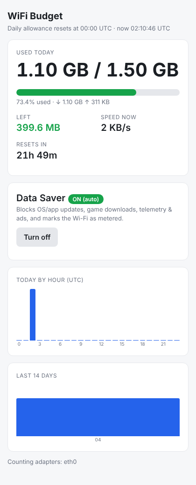

# WiFi Budget

Tracks how much data your computer uses on capped Wi-Fi (for example a ship with **1.5 GB per day**).
The count **resets every day at 00:00 UTC**. It also has a **Data Saver** mode that blocks data you don't need.



## Setup (one time, while you still have a connection)

1. Install Python 3.8 or newer from python.org (on Windows, tick **"Add Python to PATH"**).
2. Install the one dependency:
   ```
   pip install psutil
   ```
3. Copy `wifi_budget.py` somewhere handy.

## Start it

| | Command |
|---|---|
| **Windows**: open *Terminal* or *Command Prompt* **as Administrator** | `python wifi_budget.py` |
| **macOS / Linux** | `sudo python3 wifi_budget.py` |

The dashboard opens at **http://127.0.0.1:8765**. Leave the window open; usage is only counted while it runs.
If you close it and open it again **without rebooting**, it still catches up on the data used in between.

Running as admin is only needed for Data Saver. Tracking works without it.

### What the dashboard shows
- How much you've used today and how much is left (turns orange at 75% and red at 90%)
- Your current speed, and **when you'll run out at that speed**
- A countdown to the 00:00 UTC reset
- Usage by hour today, and by day for the last 14 days

You get desktop notifications at **50, 75, 90 and 100%**.

## Data Saver

Turn it on with the button in the dashboard, or `python wifi_budget.py saver on`. It does three things:

1. **Blocks** OS updates (Windows, macOS, App Store, snaps), browser and Adobe auto-updates,
   Steam, Epic and Battle.net downloads, telemetry, and ad networks (including video ads).
   Run `python wifi_budget.py blocklist` to see the full list.
2. **Marks your Wi-Fi as metered.** Windows then pauses Windows Update, OneDrive and Store downloads,
   and Linux (NetworkManager) does the same for its own background downloads.
   On macOS it switches off automatic macOS and App Store downloads instead.
3. On Windows, it **stops** the Windows Update, BITS and Delivery Optimization services.

It **turns on by itself at 80%** of the daily limit, and if it switched on automatically it **turns off
at the UTC reset**. Turning it off restores everything it changed.
A copy of your original hosts file is saved in `~/.wifi_budget/hosts.backup`.

Normal browsing, email, messaging and video calls are not blocked.

## Make the count match the ship's portal

The ship might count a little differently. If its portal says you've used 620 MB, run:
```
python wifi_budget.py set-used 620MB
```

## Settings

Edit `~/.wifi_budget/config.json` (on Windows: `C:\Users\<you>\.wifi_budget\config.json`):

```json
{
  "daily_limit_mb": 1500,
  "auto_saver_at_percent": 80,
  "warn_at_percent": [50, 75, 90, 100],
  "interfaces": [],
  "extra_blocked_domains": ["dropbox.com", "client.dropbox.com"]
}
```
- `interfaces`: leave it empty to count every real network adapter (VPN tunnels and virtual adapters are skipped).
  For the most accurate count, put only your Wi-Fi adapter here, for example `["Wi-Fi"]` (Windows) or `["en0"]` (Mac).
  The dashboard footer lists the adapters it's counting.
- `auto_saver_at_percent`: set it to `0` to turn off the automatic Data Saver.
- Or just run `python wifi_budget.py --limit 1.5GB`.

## Other commands
```
python wifi_budget.py status      # today's usage in the terminal
python wifi_budget.py history     # last 14 days
python wifi_budget.py saver off
```

## More ways to save data
- **Phone:** turn on Low Data Mode (iPhone: Settings → Wi-Fi → ⓘ → Low Data Mode) or
  Data Saver / "Treat as metered" (Android: Wi-Fi network → Advanced). Turn off iCloud Photos / Google Photos backup,
  and turn off automatic app updates. The phone's own data-usage screen shows Wi-Fi totals per app.
- **Mac:** System Settings → Wi-Fi → Details → **Low Data Mode**.
- **Streaming:** set YouTube and Netflix to 480p or lower. 1080p uses about 1.5–3 GB an hour, so your whole day's allowance.
- Install an ad blocker (uBlock Origin) and turn off video autoplay.
- Pause Dropbox, Google Drive and OneDrive sync. Pause games and app stores.
